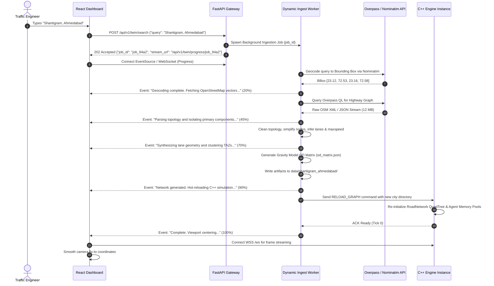
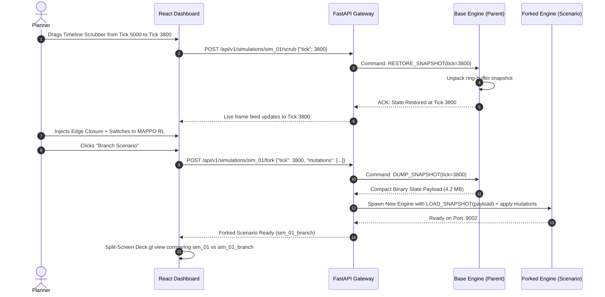
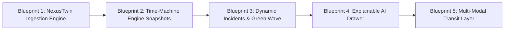

# NexusSim — Future Planning: Production Roadmap & Engineering Blueprints

> **Status:** Active Execution & Engineering Design  
> **Owner:** Core Systems Architecture & Simulation Engineering  
> **Date:** October 2026 (Updated Post-Phase 5)  
> **Scope:** Dynamic city onboarding ("NexusTwin" 2-stage ingestion), deterministic time-machine scrubber, explainable AI (XAI) signal inspection, dynamic incident & emergency green-wave routing, multi-modal simulation, multi-tenant cloud orchestration, and algorithm marketplace.

---

## 1. Executive Summary

NexusSim is currently a high-performance traffic simulation platform comprising a C++17 engine (`:9001`), Python AI sidecars (`:9003–:9006`), a unified FastAPI gateway (`:8000`), and a React 19 / deck.gl dashboard (`:3000`). Pre-computed cities (Chicago, Paris, Ahmedabad, Piedmont) provide baselines for 48 algorithms, multi-agent reinforcement learning (MAPPO), and Type-2 Fuzzy logic control.

This document serves as the **production blueprint** for evolving NexusSim beyond a closed simulator into an **autonomous, planet-scale Digital Twin operating platform ("NexusTwin")**. 

Key capabilities detailed in this document include:
1. **NexusTwin Two-Stage Dynamic Ingestion**: Live drop of OSM/PBF/GeoJSON files (Stage 1) and global search-based auto-synthesis of any neighborhood on Earth via Overpass API in $\le 20$ seconds (Stage 2).
2. **Deterministic Time-Machine & State Scrubber**: In-memory ring-buffered C++ snapshots enabling live pause, frame rewind, and what-if divergent scenario branching.
3. **Dynamic Incidents & Emergency Green-Wave Preemption**: Real-time road closures, spatial polygon hazards, and autonomous corridor green-wave preemption for first responders.
4. **Explainable AI (XAI) Real-Time Inspection Drawer**: Complete glass-box transparency into signal controllers (Type-2 Fuzzy membership activations, Webster splits, MAPPO actor-critic attention logits).
5. **Multi-Modal Transit & EV Charging Dwell**: Extended agent taxonomy (buses, trains, bicycles, pedestrians, and battery-constrained EVs).

---

## 2. Vision & Product Principles

| Principle | Meaning |
|-----------|---------|
| **City-Agnostic Core** | The engine, pathfinding QuadTree, and sidecars must never assume fixed schemas or coordinate limits. Any valid OSM graph anywhere in the world loads and simulates seamlessly. |
| **Instantaneous Digital Twin** | From typing a city name to rendering moving vehicles on the digital twin must take $\le 20$ seconds. |
| **Deterministic Reproducibility** | Given the same seed, city graph, and input events, the simulation must produce identical micro-states tick-for-tick across all platforms. |
| **Explainable Autonomy** | No "black box" signal decisions. Planners, engineers, and researchers can inspect the exact mathematical reasoning behind every phase change. |
| **Graceful Degradation** | If real-world origin-destination (OD) telemetry is unavailable, the pipeline falls back to gravity/density synthetic proxies and explicitly marks metrics as "modelled, not measured". |

---

## 3. Capability Modules

### 3.1 Two-Stage Dynamic Ingestion Pipeline ("NexusTwin")

#### Stage 1: File-Drop Digital Twin Onboarding
* **User Story**: A traffic consultant drags and drops an `.osm`, `.osm.pbf`, or `.geojson` file (up to 500 MB) onto the dashboard. The backend validates topology, synthesizes lane counts, clusters complex intersections, computes synthetic gravity OD matrices, and boots the simulation in the dashboard without restarting services.
* **Production Requirements**:
  - Direct chunked streaming upload to `data/uploads/{workspace_id}/{city_id}/`.
  - Topology sanitizer: isolates largest strongly connected component (SCC), projects to UTM/WGS84, and cleans disconnected dead ends.
  - Automatic lane synthesis: infers lane counts from OSM tags (`lanes=*`, `highway=primary|secondary|residential`) with speed-limit heuristics.
  - Synthetic OD matrix generation: clusters nodes into density-weighted traffic analysis zones (TAZs) using KMeans and generates a balanced trip matrix via the gravity model.
  - Dynamic socket hot-reload: transmits generated `graph.json` and `od_matrix.json` directly to the C++ engine over IPC/WebSocket.

#### Stage 2: Global Search-Based Auto-Synthesis
* **User Story**: A user types *"Times Square, New York"* or *"Shantigram, Ahmedabad"* into the dashboard search bar. Within 20 seconds, the system queries Overpass API, pulls road geometry and intersection topology, generates background traffic, and renders real-time traffic flow.
* **Production Requirements**:
  - Nominatim geocoding proxy: resolves free-text queries to bounding boxes (`[min_lat, min_lon, max_lat, max_lon]`).
  - Overpass QL streaming pipeline: downloads highway relations with timeout circuit breakers and mirror failover (`overpass-api.de`, `kumi.systems`, `openstreetmap.fr`).
  - $\le 20$-second end-to-end execution budget: parallel Python worker pipeline with live SSE/WebSocket status updates.
  - Instant camera jump: dashboard smoothly interpolates viewport to the new city center upon readiness.

---

### 3.2 Deterministic Time-Machine Scrubber & Scenario Branching

* **User Story**: An operator spots a congestion bottleneck forming at tick 4,200. They drag a dashboard timeline slider back to tick 3,800, change the signal policy from Fixed-Time to MAPPO RL, inject a lane restriction, and click *"Branch Scenario"*. The dashboard renders both baseline and branched trajectories side-by-side.
* **Production Requirements**:
  - C++ in-memory rolling ring-buffer holding $K=120$ full state snapshots (taken every 10 ticks = 2 minutes of real-time buffer).
  - Snapshot payload: compact binary serialization of `Agent` SoA vectors (positions, velocities, path indices, destinations), `IntersectionController` states, queue lengths, and Mersenne Twister PRNG seed.
  - Zero-copy snapshotting: memory overhead $\le 45$ MB per 50,000 agents.
  - REST & WebSocket branching contract: `POST /api/v1/simulations/{id}/fork` creates an isolated child simulation inheriting exact parent state at tick $T$.

---

### 3.3 Dynamic Incidents & Emergency Green-Wave Preemption

* **User Story**: A highway accident occurs or an ambulance needs immediate hospital transit. A dispatcher clicks an edge or draws a polygon on the map to close a road, or triggers an *"Emergency Dispatch"* from Hospital A to Incident B. The engine dynamically penalizes/disables road segments and forces a continuous green wave along the emergency vehicle's path.
* **Production Requirements**:
  - Live edge weight mutation: `RoadNetwork::set_edge_weight(edge_id, multiplier)` with $\mathcal{O}(1)$ edge penalty updates.
  - QuadTree dynamic bounding box polygon exclusion: flags all edges intersecting an incident polygon as impassable.
  - Dynamic A* rerouting: affected vehicles recalculate paths at the next intersection without engine frame drops.
  - First-responder green-wave controller: locks downstream intersection phases to Green along the emergency route, returning to normal operation 5 seconds after vehicle clears the intersection.

---

### 3.4 Explainable AI (XAI) Signal Inspection Drawer

* **User Story**: A traffic engineer clicks any intersection to understand *why* the AI allocated 45 seconds to North-South instead of East-West. A slide-out drawer displays live Type-2 Fuzzy membership functions, Webster optimum cycle calculations, and MAPPO attention weights.
* **Production Requirements**:
  - C++ telemetry payload enrichment: every decision interval emits mathematical breakdown metrics per intersection.
  - Fuzzy logic explainability: displays firing strength of Upper and Lower Membership Functions (UMF/LMF), footprint of uncertainty (FOU), and defuzzified crisp output.
  - MAPPO explainability: exposes policy action distribution probabilities, value function baseline estimate, and critic advantage.
  - Interactive SVG/Canvas visualizer in the dashboard with zero latency overhead on simulation frames.

---

### 3.5 Multi-Modal Simulation Layer & EV Charging Dwell

* **User Story**: The city simulates bus rapid transit (BRT) lanes, bike corridors, pedestrian crosswalks, and EV fleets that must navigate to charging depots when battery falls below 15%.
* **Production Requirements**:
  - Extended SoA `Agent.h` layout with `VehicleType` enum: `CAR`, `BUS`, `BIKE`, `PEDESTRIAN`, `EV`, `EMERGENCY`.
  - Transit Signal Priority (TSP): buses transmit virtual DSRC beacon when approaching within 150m, triggering green extension or early red truncation.
  - EV state machine: tracks state of charge (SoC in kWh). When $\text{SoC} < 0.15 \times \text{Capacity}$, vehicles autonomously reroute to nearest unoccupied charging node with dwell time modeling.

---

### 3.6 Multi-Tenant Cloud Orchestrator & Ephemeral Engine Pools

* **User Story**: Multiple consulting agencies manage independent city projects under isolated workspaces. Ephemeral C++ engines spawn in isolated Docker/K8s pods on-demand, execute runs, stream live WebSocket telemetry, and tear down automatically.
* **Production Requirements**:
  - Workspace JWT validation with row-level tenant isolation.
  - Ephemeral process manager: allocates dynamic engine ports (`:9100–:9900`), monitors process health, and enforces auto-reaping TTLs.
  - Token-bucket quota management: limits agent-ticks per month per tenant.

---

## 4. System Architecture & Data Flows

### 4.1 End-to-End System Topology

```
┌────────────────────────────────────────────────────────────────────────────────────────┐
│                              Clients (React 19 Dashboard, CLI)                         │
└───────────────────────────────────────────┬────────────────────────────────────────────┘
                                            │ HTTPS / WSS
┌───────────────────────────────────────────▼────────────────────────────────────────────┐
│                                FastAPI Gateway (:8000)                                 │
│  • AuthN/AuthZ (JWT + Workspace Claims)         • Rate Limiting & Quota Tracker        │
│  • Ingestion Router (/api/v1/twin/*)            • Simulation Orchestrator (/api/v1/*)  │
│  • Reverse Proxy for Engine WebSockets          • Event Bus Dispatcher (:8000/ws)      │
└─────────────────────┬───────────────────────────────────────────┬──────────────────────┘
                      │                                           │
         ┌────────────▼──────────────┐               ┌────────────▼──────────────┐
         │ Dynamic Ingestion Worker  │               │ Ephemeral Simulation Pool │
         │ (pipeline/dynamic_ingest) │               │   C++ Engine (:9001..N)   │
         │  • Overpass QL Fetcher    │               │  • SoA Agent Pool         │
         │  • Topology Cleaner       │  Hot-Reload   │  • Ring-Buffer Time-Mach. │
         │  • Lane / Speed Inferer   │──────────────>│  • Dynamic Edge Mutator   │
         │  • Synthetic OD Matrix    │  IPC / Socket │  • XAI Telemetry Streamer │
         └───────────────────────────┘               └───────────────────────────┘
```

---

### 4.2 Data Flow: Stage 2 Global Search Ingestion



---

### 4.3 Data Flow: Deterministic Time-Machine Scrubber & Branching



---

## 5. Formal Data Contracts & Schemas

### 5.1 Dynamic Ingestion Request & Progress Event

#### Request Payload (`POST /api/v1/twin/search`)
```json
{
  "workspace_id": "ws_enterprise_01",
  "query": "Shantigram, Ahmedabad, Gujarat, India",
  "buffer_meters": 1500,
  "default_speed_kmh": 45.0,
  "agent_density_target": 2500,
  "signal_inference": "smart"
}
```

#### Progress Event Protocol (`GET /api/v1/twin/progress/{job_id}`)
```json
{
  "job_id": "job_94a2e8",
  "stage": "LANE_SYNTHESIS",
  "progress_pct": 65,
  "elapsed_seconds": 7.4,
  "eta_remaining_seconds": 3.8,
  "message": "Synthesizing multi-lane corridors and turn-pocket geometry",
  "metrics": {
    "nodes_extracted": 3840,
    "edges_synthesized": 7920,
    "intersections_clustered": 340,
    "od_pairs_generated": 1250
  },
  "error": null
}
```

---

### 5.2 Deterministic State Snapshot Binary Layout (C++ `SnapshotHeader`)

```cpp
#pragma pack(push, 1)
struct SnapshotHeader {
    uint32_t magic;            // 0x4E585353 ("NXSS" - NexusSim Snapshot)
    uint16_t version;          // 0x0002 (Version 2.0)
    uint64_t tick;             // Simulation tick index
    double sim_time_seconds;   // Exact elapsed simulation time
    uint32_t agent_count;      // Active agent count
    uint32_t controller_count; // Number of intersection controllers
    uint64_t prng_state;       // Mersenne Twister internal seed state
    uint32_t payload_bytes;    // Total size of compressed entity payload
    uint32_t crc32_checksum;   // Integrity verification checksum
};

struct AgentSnapshotRecord {
    uint32_t agent_id;
    float pos_x;
    float pos_y;
    float velocity;
    float acceleration;
    uint32_t current_edge_id;
    float edge_offset;
    uint32_t current_path_step;
    uint8_t state_flags;       // Bit 0: rerouting, Bit 1: emergency, Bit 2: charging
};

struct ControllerSnapshotRecord {
    uint32_t intersection_id;
    uint8_t current_phase;
    float time_in_phase;
    float queue_lengths[4];
};
#pragma pack(pop)
```

---

### 5.3 Dynamic Incident & Green-Wave Payload

#### Incident Road Closure (`POST /api/v1/simulations/{id}/incident`)
```json
{
  "incident_id": "inc_7749",
  "type": "ROAD_CLOSURE",
  "polygon_wgs84": [
    [72.5512, 23.1415],
    [72.5535, 23.1415],
    [72.5535, 23.1430],
    [72.5512, 23.1430]
  ],
  "affected_edge_ids": [4201, 4202],
  "penalty_multiplier": 1e9,
  "duration_ticks": 6000,
  "auto_reroute_vehicles": true
}
```

#### Emergency Green-Wave Preemption (`POST /api/v1/simulations/{id}/emergency-wave`)
```json
{
  "emergency_id": "emg_991",
  "origin_node": 1042,
  "destination_node": 8941,
  "vehicle_id": "ambulance_alpha_01",
  "green_wave_corridor": [1042, 1048, 1102, 1250, 8941],
  "lead_time_seconds": 15.0,
  "clearance_hold_seconds": 5.0
}
```

---

### 5.4 Explainable AI (XAI) Telemetry Payload

```json
{
  "tick": 4500,
  "intersection_id": 104,
  "active_policy": "TYPE2_FUZZY",
  "explanation": {
    "cycle_length_seconds": 90.0,
    "allocated_phase": 0,
    "phase_duration_seconds": 42.5,
    "decision_factors": [
      {
        "approach": "NORTH_BOUND",
        "queue_length": 18,
        "urgency_score": 0.84,
        "fuzzy_membership": {
          "lower_mf": 0.72,
          "upper_mf": 0.91,
          "firing_strength": 0.815,
          "linguistic_term": "HEAVY_CONGESTION"
        }
      },
      {
        "approach": "EAST_BOUND",
        "queue_length": 4,
        "urgency_score": 0.22,
        "fuzzy_membership": {
          "lower_mf": 0.15,
          "upper_mf": 0.30,
          "firing_strength": 0.225,
          "linguistic_term": "LIGHT_FLOW"
        }
      }
    ],
    "alternative_comparison": {
      "fixed_webster_recommendation_seconds": 32.0,
      "fuzzy_gain_seconds": 10.5,
      "confidence_score": 0.94
    }
  }
}
```

---

## 6. API Contracts (Gateway)

### 6.1 Two-Stage Ingestion Endpoints
| Method | Path | Description | Query / Body |
|--------|------|-------------|--------------|
| `POST` | `/api/v1/twin/upload` | Stage 1: Chunked upload of `.osm`/`.pbf`/`.geojson` | Multipart form (`file`, `workspace_id`, `city_name`) |
| `POST` | `/api/v1/twin/search` | Stage 2: Global geocoded search & auto-synthesis | `{"query": "...", "workspace_id": "..."}` |
| `GET` | `/api/v1/twin/progress/{job_id}` | Server-Sent Events (SSE) live progress stream | Returns SSE `data: {...}` stream until `COMPLETE` |
| `GET` | `/api/v1/twin/cities` | List dynamic cities registered in workspace | Returns array of synthesized city metadata |

### 6.2 Time-Machine & State Scrubber Endpoints
| Method | Path | Description | Query / Body |
|--------|------|-------------|--------------|
| `GET` | `/api/v1/simulations/{id}/timeline` | Returns snapshot index list and tick ranges | Response: `{"ticks": [0, 100, 200...], "active": 4500}` |
| `POST` | `/api/v1/simulations/{id}/scrub` | Rewind/fast-forward simulation to historic tick | Body: `{"target_tick": 3800}` |
| `POST` | `/api/v1/simulations/{id}/fork` | Fork simulation at target tick into new scenario | Body: `{"tick": 3800, "name": "Scenario A", "mutations": [...]}` |

### 6.3 Incidents & Emergency Green-Wave Endpoints
| Method | Path | Description | Query / Body |
|--------|------|-------------|--------------|
| `POST` | `/api/v1/simulations/{id}/incident` | Create spatial road closure / incident polygon | Body: `IncidentPayload` (see 5.3) |
| `DELETE` | `/api/v1/simulations/{id}/incident/{inc_id}` | Clear incident and restore road capacities | Path: `inc_id` |
| `POST` | `/api/v1/simulations/{id}/emergency-wave` | Activate emergency green-wave corridor | Body: `EmergencyWavePayload` (see 5.3) |

### 6.4 Explainable AI (XAI) Endpoints
| Method | Path | Description | Query / Body |
|--------|------|-------------|--------------|
| `GET` | `/api/v1/simulations/{id}/xai/{intersection_id}` | Retrieve real-time XAI decision explanation | Response: `XAIExplanationPayload` (see 5.4) |
| `GET` | `/api/v1/simulations/{id}/xai/summary` | City-wide ranking of bottleneck intersections | Returns top 10 most congested intersections with reasoning |

---

## 7. Step-by-Step Engineering Execution Blueprints



---

### Blueprint 1: NexusTwin 2-Stage Dynamic Ingestion Pipeline

#### Implementation Objective
Deliver sub-20 second dynamic digital twin generation from a search query or drag-and-drop file, streaming updates directly to the frontend and dynamically launching the C++ engine.

#### Step 1.1: Build Streaming Ingestion Core (`pipeline/src/dynamic_ingest.py`)
1. Create a `DynamicIngestionWorker` class supporting both `ingest_file(filepath)` and `ingest_query(query_text)`.
2. Connect to `Nominatim` with custom User-Agent to retrieve bounding box coordinates:
   ```python
   # Bounding box extraction with 1000m buffer
   params = {"q": query_text, "format": "json", "limit": 1}
   ```
3. Formulate optimized Overpass QL query targeting drivable highway networks:
   ```text
   [out:json][timeout:25];
   (
     way["highway"~"motorway|trunk|primary|secondary|tertiary|residential"](bbox);
   );
   out body;
   >;
   out skel qt;
   ```
4. Stream progress callbacks at every pipeline phase:
   - `0% - 25%`: Overpass query execution and raw JSON/XML stream parsing.
   - `25% - 50%`: NetworkX multi-di-graph topology cleanup (isolate largest SCC, remove duplicate nodes, compute bearings).
   - `50% - 75%`: Lane synthesis and intersection clustering (infer lanes, assign saturation flow rates).
   - `75% - 90%`: Synthetic OD matrix generation using centroid KMeans clustering and distance-decay gravity formulation:
     $$T_{ij} = \frac{P_i A_j d_{ij}^{-\gamma}}{\sum_k A_k d_{ik}^{-\gamma}}$$
   - `90% - 100%`: Save `graph.json`, `od_matrix.json`, `metadata.json` to `data/{slug}/` and notify caller.

#### Step 1.2: Add FastAPI Ingestion Router (`gateway/twin_router.py`)
1. Create endpoints: `POST /api/v1/twin/upload`, `POST /api/v1/twin/search`, and `GET /api/v1/twin/progress/{job_id}`.
2. Use an asynchronous thread pool worker with Python `asyncio` queues to stream Server-Sent Events (SSE).
3. Implement failover mirrors for Overpass API:
   - Primary: `https://overpass-api.de/api/interpreter`
   - Secondary: `https://overpass.kumi.systems/api/interpreter`
   - Tertiary: `https://maps.mail.ru/osm/tools/overpass/api/interpreter`

#### Step 1.3: C++ Engine Dynamic Graph Reload (`engine/src/Simulation.cpp`)
1. Implement `Simulation::reload_city(const std::string& city_path)`:
   - Safely drain running worker threads.
   - Re-instantiate `RoadNetwork` QuadTree from the new `graph.json`.
   - Allocate agent memory pools according to new OD demands.
   - Reset simulation clock to tick 0.
   - Broadcast `CITY_RELOADED` notification over WebSocket `:9001`.

#### Step 1.4: React Dashboard Twin Importer UI (`dashboard/src/components/TwinImporterModal.tsx`)
1. Implement dynamic search bar with debounce (400ms) and location suggestions.
2. Implement file drop-zone accepting `.osm`, `.pbf`, `.geojson`.
3. Render animated multi-stage progress bar showing live metrics (nodes cleaned, edges generated, time elapsed).
4. Auto-switch deck.gl map view using `LinearInterpolator` / `FlyToInterpolator` to center on the new city.

---

### Blueprint 2: Deterministic Time-Machine & State Scrubber

#### Implementation Objective
Allow users to pause, rewind, scrub, and branch simulations tick-for-tick with $\le 50$ms seek latency.

#### Step 2.1: C++ In-Memory Ring Buffer (`engine/src/SnapshotBuffer.h`)
1. Implement a circular ring-buffer storing the last $N=120$ snapshots:
   ```cpp
   class SnapshotRingBuffer {
   public:
       void push_snapshot(uint64_t tick, const SimulationState& state);
       bool get_snapshot(uint64_t tick, SimulationState& out_state);
       std::vector<uint64_t> get_available_ticks() const;
   private:
       static constexpr size_t CAPACITY = 120;
       std::array<std::vector<uint8_t>, CAPACITY> buffer_;
       std::array<uint64_t, CAPACITY> tick_index_;
       size_t head_ = 0;
   };
   ```
2. Serialize agents using flat packed memory structures (`AgentSnapshotRecord`) with Zstandard (zstd) compression to keep memory usage under 50 MB.

#### Step 2.2: State Restoration Logic (`engine/src/Simulation.cpp`)
1. On `RESTORE_SNAPSHOT(target_tick)` command:
   - Locate target tick in `SnapshotRingBuffer`.
   - Decompress binary buffer and populate `Agent` SoA vectors.
   - Restore intersection phase counters and approach queue lengths.
   - Seed `std::mt19937_64` PRNG with the snapshot's recorded state to ensure deterministic forward progression.
   - Send WebSocket synchronization frame to dashboard.

#### Step 2.3: Forking & Scenario Comparison (`gateway/scenario_orchestrator.py`)
1. Implement `POST /api/v1/simulations/{id}/fork`:
   - Fetch snapshot bytes from primary engine at target tick.
   - Spawn secondary engine on next available port (e.g. `:9002`).
   - Deliver snapshot via TCP/Socket initialization.
   - Apply requested mutations (e.g., change signal policy, close edge).
   - Return new `simulation_id`.

#### Step 2.4: Timeline Scrubber Component (`dashboard/src/components/TimelineScrubber.tsx`)
1. Timeline track displaying buffered tick range, current tick, and key event markers (incidents, policy switches).
2. Smooth scrubbing slider with immediate live frame preview.
3. *"Branch Scenario"* button that triggers split-screen Deck.gl comparison view.

---

### Blueprint 3: Dynamic Incidents & Emergency Green-Wave Routing

#### Implementation Objective
Enable interactive road closures and instant green-wave preemption for emergency vehicles with real-time vehicle rerouting.

#### Step 3.1: Road Network Edge Weight Mutator (`engine/src/RoadNetwork.h`)
1. Maintain edge cost multipliers in a fast flat array: `std::vector<float> edge_penalties_`.
2. In pathfinding A*, edge weight is evaluated as:
   $$W(e) = \frac{\text{length}(e)}{\text{maxspeed}(e)} \times \text{edge\_penalties\_}[e]$$
3. When an edge is closed, set `edge_penalties_[e] = 1e9f` (effectively infinite, preventing traversal while preserving graph integrity).

#### Step 3.2: Polygon Collision Detection for Disasters
1. In `RoadNetwork::apply_polygon_incident(const std::vector<Point>& poly, float penalty)`:
   - Query QuadTree to retrieve all edges intersecting the incident bounding box.
   - Run Sutherland-Hodgman / Ray-Casting algorithm to test edge geometry against the polygon.
   - Penalize all interior edges.
   - Flag all vehicles currently traveling toward closed edges to recalculate routes at their next node.

#### Step 3.3: Emergency Vehicle Green-Wave Controller (`engine/src/SignalController.h`)
1. When emergency vehicle $V_{emg}$ approaches within distance $D_{trigger} = 250$m of intersection $I$:
   - Identify approach bearing of $V_{emg}$.
   - Force controller phase to Green for that approach corridor.
   - Hold phase until $V_{emg}$ exits the intersection, plus 3.0 seconds safety buffer.
   - Resume standard signal policy with smooth transition offset to prevent phase starvation on opposing approaches.

#### Step 3.4: Dashboard Incident Canvas (`dashboard/src/components/IncidentDrawingOverlay.tsx`)
1. Add map interaction tools:
   - *Road Closure Tool*: Click edge to toggle block/unblock.
   - *Hazard Polygon Tool*: Click to draw emergency containment zone.
   - *Emergency Dispatcher*: Click origin and destination to launch an emergency vehicle and watch the green-wave corridor illuminate.

---

### Blueprint 4: Explainable AI (XAI) Signal Inspection Drawer

#### Implementation Objective
Provide real-time mathematical interpretability of Type-2 Fuzzy, Webster, and MAPPO signal decisions to eliminate "black-box" skepticism.

#### Step 4.1: Controller Math Telemetry Extraction (`engine/src/IntersectionController.cpp`)
1. Extend `IntersectionController` to record decision metrics:
   - **Type-2 Fuzzy Logic**:
     - Upper/Lower Membership values ($\mu_{\tilde{A}}(x)$) for approach queues.
     - Rule firing strengths ($f^i = [\underline{f}^i, \bar{f}^i]$).
     - Karnik-Mendel defuzzification intervals ($[y_l, y_r]$) and crisp output $y$.
   - **Webster Fixed-Time Formula**:
     - Critical lane flows ($y_i = q_i / s_i$), total flow ratio ($Y = \sum y_i$).
     - Optimum cycle length:
       $$C_0 = \frac{1.5L + 5}{1 - Y}$$
     - Green split allocation per phase.
   - **MAPPO RL**:
     - Policy head Softmax action probabilities: $P(\text{Phase} = k \mid s)$.
     - State-value estimation: $V(s)$.
2. Package telemetry into `/inspect/intersection/{id}` payload.

#### Step 4.2: Frontend Inspection Drawer (`dashboard/src/components/XaiInspectionDrawer.tsx`)
1. Slide-out panel triggered by clicking any intersection on the Deck.gl canvas.
2. Render interactive visual components:
   - **Fuzzy Membership Curve**: Visualizes Gaussian/Triangular footprint of uncertainty (FOU) with live marker showing current queue reading.
   - **Webster vs AI Bar Chart**: Side-by-side comparison of fixed mathematical optimum vs AI-allocated seconds.
   - **Corridor Flow Radar**: 4-way radial chart showing directional flow, wait time, and congestion index.

---

### Blueprint 5: Multi-Modal Transit Layer & EV Fleet Charging

#### Implementation Objective
Simulate mixed traffic networks featuring private cars, public transit buses with signal priority, cyclists, pedestrians, and battery-constrained EVs.

#### Step 5.1: Structure of Arrays (SoA) Expansion (`engine/src/Agent.h`)
1. Update agent memory layout:
   ```cpp
   struct AgentPool {
       std::vector<float> x;
       std::vector<float> y;
       std::vector<float> speed;
       std::vector<uint32_t> edge_id;
       std::vector<uint8_t> vehicle_type; // 0=CAR, 1=BUS, 2=BIKE, 3=PEDESTRIAN, 4=EV
       std::vector<float> battery_soc;    // 0.0 to 1.0 (for EVs)
       std::vector<float> max_accel;      // Specific per vehicle type
       std::vector<float> length;         // Physical vehicle footprint (meters)
   };
   ```
2. Define acceleration/deceleration kinematics per mode:
   - `BIKE`: Max speed 20 km/h, footprint 1.8m, acceleration $1.2 \text{ m/s}^2$.
   - `BUS`: Max speed 50 km/h, footprint 12.0m, acceleration $1.0 \text{ m/s}^2$, carry factor 40 passengers.
   - `EV`: Same kinematic profile as `CAR`, but tracks consumption:
     $$\Delta \text{SoC} = \frac{(P_{\text{traction}} + P_{\text{aux}}) \times \Delta t}{\text{BatteryCapacity}}$$

#### Step 5.2: EV Charging Queue Modeling
1. Designate specific nodes in `RoadNetwork` as `ChargingStation` entities with $N$ stalls.
2. When an EV's battery drops below 15%, intercept current path and route to the nearest available charging station using Dijkstra path search.
3. Model dwell time at charging station (e.g. 15 minutes = 900 ticks) before resuming original destination trip.

---

## 8. Risk Assessment & Engineering Mitigations

| Risk | Impact | Mitigation Strategy |
|------|--------|---------------------|
| **Overpass API Rate Limiting / Downtime** | High (Stage 2 fails) | Maintain a 3-tier mirror failover pool (`overpass-api.de`, `kumi.systems`, `mail.ru`). Cache raw query responses in local SQLite/Redis by normalized BBox hash. |
| **Large OSM Graph Memory Spike** | High (OOM crash) | Apply strict bounding box caps (maximum $15 \times 15$ km area per dynamic search). Run graph simplification in Python worker before serializing to engine JSON. |
| **Time-Machine Memory Footprint** | Medium (High RAM usage) | Use differential snapshotting (delta compression) and limit ring-buffer capacity to 120 ticks. Compress agent vectors with Zstandard (`zstd`). |
| **Emergency Rerouting Overhead** | Medium (Frame drops) | Stagger rerouting requests over 5–10 ticks using an asynchronous pathfinding task queue rather than recalculating all vehicles simultaneously. |
| **Non-Deterministic Snapshots** | Critical (Fork divergence) | Pin 64-bit Mersenne Twister seed state in snapshot header; freeze all external non-deterministic thread interleaving during snapshot export. |

---

## 9. Success Verification Metrics

| Capability Milestone | Target KPI | Verification Method |
|----------------------|------------|---------------------|
| **Stage 1: File Drop Ingestion** | $\le 10$ seconds | Upload 20 MB `.osm` file via dashboard; measure duration until first tick renders. |
| **Stage 2: Overpass Search Ingestion** | $\le 20$ seconds | Search *"Shantigram, Ahmedabad"*; verify complete geocoding, download, and sim start within 20s. |
| **Time-Machine Scrubber Seek** | $\le 50$ ms | Request `POST /scrub` across 1,000 historic ticks; confirm zero frame stutter. |
| **Deterministic Forking** | 100% Bit-Identical | Fork simulation at tick 2,000 without mutations; confirm child simulation produces identical agent positions for 1,000 ticks. |
| **Emergency Green-Wave Clearance** | $\ge 40\%$ Travel Time Drop | Compare travel time of emergency vehicle with green-wave enabled vs standard traffic baseline. |
| **Explainable AI Telemetry** | $\le 5$ ms Overhead | Measure engine tick time with XAI telemetry logging active vs disabled. |

---

## 10. Execution Roadmap & Phase Deliverables

```
Phase 6: NexusTwin Ingestion Engine (Current)
  ├── 6.1: Dynamic Ingestion Service (pipeline/src/dynamic_ingest.py)
  ├── 6.2: Gateway Ingestion API & Overpass Failover (gateway/twin_router.py)
  ├── 6.3: C++ Graph Hot-Reload Socket Handler (engine/src/Simulation.cpp)
  └── 6.4: React Dashboard Twin Importer Modal (dashboard/src/components/)

Phase 7: Time-Machine & State Scrubber
  ├── 7.1: In-Memory Ring Buffer & Binary Serialization (engine/src/SnapshotBuffer.h)
  ├── 7.2: Engine RESTORE & FORK Commands (engine/src/Simulation.cpp)
  ├── 7.3: Gateway Timeline & Branching API (gateway/server.py)
  └── 7.4: Dashboard Scrubber & Split-Screen Comparison (dashboard/src/components/)

Phase 8: Incidents, Green-Wave & Explainable AI (XAI)
  ├── 8.1: Dynamic Edge Cost & Polygon Hazard Mutator (engine/src/RoadNetwork.h)
  ├── 8.2: First-Responder Corridor Green-Wave Preemption (engine/src/SignalController.h)
  ├── 8.3: Type-2 Fuzzy & MAPPO Telemetry Exporter (engine/src/IntersectionController.cpp)
  └── 8.4: Dashboard Incident Drawing Overlay & XAI Drawer (dashboard/src/components/)

Phase 9: Multi-Modal Transit & EV Charging Infrastructure
  ├── 9.1: Multi-Modal SoA Agent Pool (engine/src/Agent.h)
  ├── 9.2: Transit Signal Priority (TSP) DSRC Simulation (engine/src/SignalController.h)
  └── 9.3: EV Battery Depletion & Charging Queue Management (engine/src/RoadNetwork.h)
```

---

*This document serves as the authoritative architectural blueprint for all subsequent NexusSim engineering cycles.*